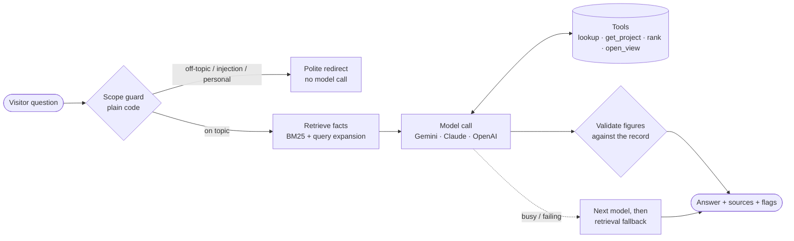
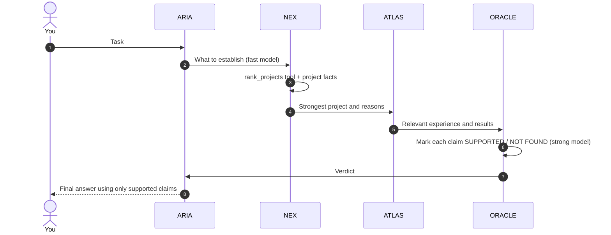

<div align="center">



<br/>

<a href="https://arshdeepsingh-portfolio.vercel.app"></a>
<a href="https://github.com/arshdeepsingh11"></a>
<a href="https://www.linkedin.com/in/arshdeep-singh-software/"></a>


### I build what you can imagine.

**Websites · mobile apps · AI assistants · healthcare platforms · online stores · the systems behind them**

</div>

---

## 👋 Who I am

I'm **Arshdeep Singh**, a software developer in **Calgary, Canada**, working at the intersection of code and AI.

- 🧠 **Now:** Full Stack Developer at **BioAro Inc** (since November 2025). I build **BioEMR**, an Electronic Medical Record platform with AI features, HL7 configuration, HIPAA compliance and Netcare / Connect Care integrations. I also built **Neyu**, an AI health companion for a Calgary cardiology clinic, and shipped **6+ live client websites**.
- 🏗️ **Before:** Full Stack Developer at **Visionaries Tech Solutions** (2022 – 2023): React, Next.js, Node.js, BI dashboards, PostgreSQL and MongoDB.
- 🎓 **Education:** Software Development Diploma, **Southern Alberta Institute of Technology (SAIT)**, August 2025.
- 🔭 **Exploring:** LLMs, RAG systems, intelligent agents, vector databases and agentic workflows, in production rather than in demos.

<table>
<tr>
<td align="center"><h2>22</h2>AI features in NEYU Health</td>
<td align="center"><h2>608</h2>automated checks in NEYU</td>
<td align="center"><h2>20%</h2>fewer production defects</td>
<td align="center"><h2>30%</h2>less manual testing</td>
<td align="center"><h2>15</h2>project worlds</td>
</tr>
</table>

<sub>Figures come from my résumé and repository READMEs. The site checks every number its agents say against them.</sub>

### What I build

| | | |
|---|---|---|
| 🤖 **AI assistants & agents**<br/>Answers from your own data, with evidence and guardrails | 🌐 **Full-stack platforms**<br/>Accounts, databases, admin consoles, payments | 📱 **Mobile apps**<br/>Expo, React Native and Capacitor, with secure sign-in |
| 🏥 **Healthcare software**<br/>HL7, HIPAA, audit trails, clinical safety | 🛍️ **Online stores**<br/>Shopify, Stripe, multi-market storefronts | 📊 **Dashboards & automation**<br/>BI, analytics, CI test automation |
| 🧊 **3D & interactive**<br/>Three.js, WebGL, motion | 🚀 **Websites that ship**<br/>Branded, responsive, search-aware | ✨ **And whatever you can imagine**<br/>[Start a project →](https://arshdeepsingh-portfolio.vercel.app/collab) |

---

## 🌌 What ARSH/OS is

ARSH/OS is my portfolio, built as a small operating system for my work instead of a page of links.

| | |
|---|---|
| 🛰️ **Six AI agents** | ARIA (guide), NEX (code), PIXEL (design), ATLAS (career), ORACLE (AI), NOVA (projects). Each is an animated 3D character with nine states, and a real server-side model call grounded in verified facts. |
| 🕸️ **Intelligence Network** | Give the agents a task. They work in separate calls, ORACLE verifies every claim, and ARIA presents only what survived. It is streamed live, stage by stage. |
| 🪐 **Project Multiverse** | 15 repositories as worlds. Live sites open **inside the page** in a working browser window, and 12 projects run as **interactive demos** rebuilt from their real code. Each has an architecture walk, code and facts. |
| 🧠 **AI Explained** | 13 ideas (LLMs, tokens, context, embeddings, RAG, agents, guardrails, evaluation, multi-agent, fine-tuning, multimodal, vector DBs, cost) explained simply, each with an interactive visual. Some run this site's real retrieval, guard and checker in your browser. |
| 🧪 **Intelligence Lab** | Train a neural network live, build an AI architecture, grade answers, run a Monte Carlo model, automate a workflow. |
| 🏛️ **The Foundation** | SAIT Software Development as an explorable tower of program outcomes, linked to the work they led to. |
| 🔐 **Credential Vault** | Certificates as watermarked presentation copies behind signed, expiring links. Originals never ship. |
| 💬 **Collaborate** | NOVA turns an idea into a clear brief and sends it by email, or hands it to your own mail app. It never pretends to have sent anything. |

### How an agent answers



### The Intelligence Network



---

## ⚡ Run it locally

> Requires **Node.js 20.9+**.

```bash
# 1. Install
npm install

# 2. Configure: .env.local is included with Gemini set up.
#    To start from scratch instead: cp .env.example .env.local

# 3. Start
npm run dev            # → http://localhost:3000
```

**Check that the agents are live:** open **http://localhost:3000/api/agents/status?probe=1**.

- `"ok": true` → Gemini answered. The status bar shows **Agents: live model**.
- `"ok": false` → the response includes Google's own error message (for example an invalid key or an unavailable model).

| Command | What it does |
|---|---|
| `npm run dev` | Development server |
| `npm run build && npm start` | Production build and server |
| `npm run typecheck` | Strict TypeScript |
| `npm test` | 29 tests: retrieval, guard, validation, orchestration, all three providers' wire formats, every API route |
| `npm run certificates` | Regenerate certificate presentation copies from originals (see below) |

### Environment

| Variable | Needed | Purpose |
|---|---|---|
| `AI_PROVIDER` | ✓ for live agents | `gemini`, `anthropic`, `openai` or `demo` |
| `GEMINI_API_KEY` / `ANTHROPIC_API_KEY` / `OPENAI_API_KEY` | ✓ for live agents | Only the one you use. Server-only; never sent to the browser. |
| `AI_MODEL`, `AI_MODEL_FAST` | optional | Override models. Gemini default: `gemini-3.8-flash`. |
| `AI_FALLBACK_MODELS` | optional | Gemini models to try when the main one is busy or unavailable. Default `gemini-3.6-flash,gemini-2.5-flash`. |
| `CERT_SIGNING_SECRET` | recommended | Signs certificate image links. If missing, a key is derived from your AI key so the Vault still works. |
| `GITHUB_TOKEN` | optional | Raises the GitHub API limit from 60 to 5,000 requests/hour. |
| `RESEND_API_KEY`, `CONTACT_TO`, `CONTACT_FROM` | optional | Real email from the Collaborate page. |

> 🔑 **Keep `.env.local` private.** It is git-ignored. Because the Gemini key in it was shared in a chat, create a new key in Google AI Studio and replace it when you can.

### Deploy to Vercel

1. Push the folder to GitHub and import it at [vercel.com/new](https://vercel.com/new). The framework preset is Next.js, with nothing else to change.
2. In **Settings → Environment Variables**, add `AI_PROVIDER`, `GEMINI_API_KEY` and `CERT_SIGNING_SECRET` (copy them from `.env.local`). `GITHUB_TOKEN` is recommended.
3. Deploy, then open `/api/agents/status?probe=1` on your domain to confirm the agents are live.

The Intelligence Network streams for up to 120 s. On the Hobby plan, set `maxDuration` to 60 in `src/app/api/agents/network/route.ts`.

---

## 🛡️ How the AI stays honest

- **Guard before the model.** Plain code catches prompt injection, unrelated tasks (essays, code for you, weather), personal questions (age, family, address, pay) and commitments (rates, deadlines). The agent politely redirects, and no model call is made.
- **Briefed agents.** Each agent has a written job, shared limits, the site map and only the facts it needs.
- **Retrieval first.** Answers come from verified passages, never from the model's memory.
- **Validation after.** Any figure not found in the record is flagged on screen.
- **Fallbacks.** If a Gemini model is over quota or busy, the next model answers. If all fail, a clearly labelled retrieval answer appears.
- **No pretending.** Demo mode, fallbacks and guard answers are all labelled. The Network stops rather than invent a failed step.

## 🪟 Live windows

Project pages and the Multiverse open live sites in a real embedded browser (desktop, tablet and phone widths). The server first reads each site's `X-Frame-Options` and `Content-Security-Policy` headers. Sites that forbid framing (a normal security choice) get a clear notice and an *Open* button instead of a blank box. Only sites listed in `src/lib/content/extra.ts` can be checked.

## 🔐 Certificates

Originals never enter the repository. Put scans in `certificates-originals/` (git-ignored) and run `npm run certificates`. That writes 760-px copies with personal details blurred and the watermark baked in to `private/certificates/`. They are served only through signed links that expire after 15 minutes. **Nothing on the web can prevent screenshots**, and the site says so.

## 🗂️ Structure

```
src/app/                 routes · api/agents (status, chat, network) · api/embed · api/contact · api/certificates · api/github · ai/
src/lib/content/         verified content: index.ts (record, projects), extra.ts (capabilities, FAQ, live sites), ai.ts (AI curriculum), agents.ts
src/lib/agents/          knowledge · retrieval · guard · prompts · tools · conversation · orchestrator
src/lib/ai/              provider abstraction: gemini.ts (model fallback, thinking config) · anthropic.ts · openai.ts
src/lib/characters/      six procedural 3D characters, nine states, one WebGL context
src/components/          shell · agents · views · demos (12 + live window) · ai (13 interactive visuals)
tests/                   node:test suites
```

## 🔒 Privacy

No analytics, no cookies, no database. Conversations stay in the browser tab. The microphone is only requested when you press dictate.

## 📝 Notes on the record

- Two résumé versions disagree on titles and dates. This site follows the AI-focused one. Edit `experience` in `src/lib/content/index.ts` if needed.
- Certificate names come from the certificates themselves ("Core Java", "Web Designing", "Shineway Software Solution").
- Contribution notes exist for NEYU; add yours for other projects in the same file.

---

<div align="center">

**Have something in mind?**

[✉️ arsh.016vs@gmail.com](mailto:arsh.016vs@gmail.com) · [💼 LinkedIn](https://www.linkedin.com/in/arshdeep-singh-software/) · [🐙 GitHub](https://github.com/arshdeepsingh11) · [🌐 Portfolio](https://arshdeepsingh-portfolio.vercel.app)

<sub>Built with Next.js, React, TypeScript, three.js and a lot of care in Calgary.</sub>

</div>
